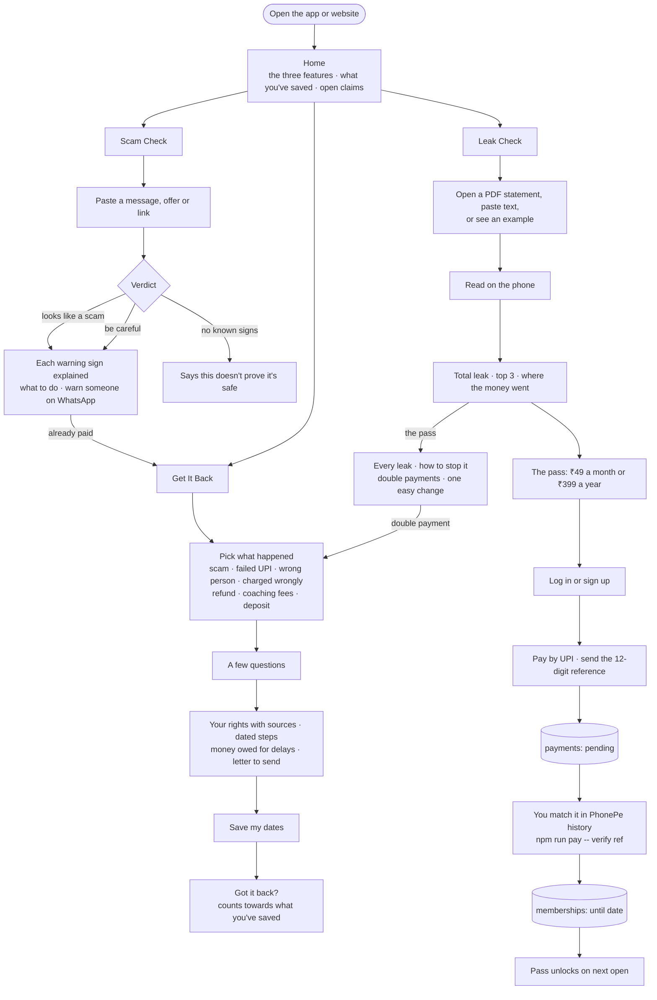

# App flow

Four tabs: **Home · Scam Check · Get It Back · Leak Check**. Everything is open without an account. The person icon opens your account and settings. Every screen outside the tabs has a back button.

| Where | What lives there |
| --- | --- |
| Home `#/` | The three features, what you've saved, open claims, questions |
| Scam Check `#/scam` | Paste box, examples, verdict, what to do, warn someone |
| Get It Back `#/back` | Seven situations. `#/back/<id>` is one situation, `?claim=<id>` reopens a saved one |
| Leak Check `#/leak` | Statement reader and report |
| The pass `#/plus` | Pay by UPI, your payments |
| You `#/me` | Log in or out, theme, app version, delete account |
| Log in `#/login` | Sign up and log in. `?next=/plus` comes back to the pass |
| Shield `#/shield` | Safety: helplines, fake call, siren, send location, self-defence. Linked from the footer |
| Get the app `#/get` | APK and install help |
